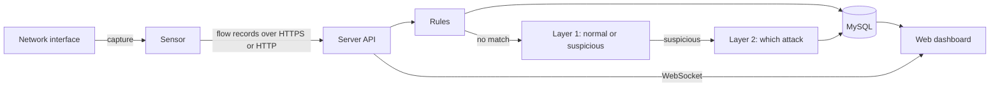

# IntrusionSense

A network intrusion detection system with a web dashboard. A small **sensor** watches the traffic on a machine, a **server** decides which flows are attacks, and you triage the alerts in your browser as they arrive.

- **Live alerts** with a 24-hour activity strip, search, filters and triage (acknowledge, false positive, resolve).
- **Two-stage detection.** Rules you control run first (port scans, connection floods, web attack signatures, allowlists). Then a machine-learning model decides whether a flow is suspicious and, if so, which attack it is.
- **Roles.** Admin, Manager and SOC Analyst, enforced on the server. Every sign-in and change is logged.
- **Runs in Docker** on Windows, macOS and Linux. The sensor runs on the machine you want to watch.



The sensor sends flow statistics only (counts, sizes, timings and up to five short request samples), never full packet captures.

## Quick start

You need [Docker](https://docs.docker.com/get-started/get-docker/) (Docker Desktop on Windows and macOS, Docker Engine on Linux).

1. Download `docker-compose.yml` from the [latest release](https://github.com/TonnyGol/IntrusionSense-IDS/releases/latest).
2. In the same folder run:

   ```bash
   docker compose up -d
   ```

3. Open <http://127.0.0.1:8000>. The first visit asks you to create the admin account.

Nothing else to configure: the first start generates the database password and the session secret and keeps them in a private Docker volume. The dashboard is reachable from your own computer only.

### Watch a machine

Open **Sensors** in the dashboard, choose **Register sensor**, and copy the token it shows once. Then run the sensor on the machine you want to watch.

**Linux, in Docker** (sees the host's real traffic): put `SENSOR_TOKEN=<token>` in a file named `.env` next to `docker-compose.yml`, then

```bash
docker compose --profile capture up -d
```

**Windows.** Docker on Windows cannot see your real network card, so the sensor runs as a normal program.

1. Install [Npcap](https://npcap.com/) (tick *WinPcap API-compatible mode*).
2. Download `intrusionsense-sensor-windows-x64.exe` from the release.
3. In an Administrator PowerShell:

   ```powershell
   $env:INTRUSIONSENSE_SENSOR_TOKEN = "<token>"
   .\intrusionsense-sensor-windows-x64.exe --server http://127.0.0.1:8000
   ```

   Windows SmartScreen may warn about an unsigned program: choose *More info*, then *Run anyway*.

**macOS.** Download `intrusionsense-sensor-macos-arm64` (Apple silicon) or `-macos-x64` (Intel):

```bash
chmod +x intrusionsense-sensor-macos-*
xattr -d com.apple.quarantine intrusionsense-sensor-macos-*   # the program is not signed
sudo INTRUSIONSENSE_SENSOR_TOKEN=<token> ./intrusionsense-sensor-macos-arm64 --server http://127.0.0.1:8000
```

**Another computer.** Point `--server` at the server's address. The dashboard only listens on `127.0.0.1` by default; publish it deliberately and put it behind HTTPS before you do (set `SESSION_COOKIE_SECURE=true`).

The sensor picks the interface with your default route. If it picks the wrong one (common with VPNs or several adapters), run it with `--list-interfaces` to see the names and pass one with `--iface "<name>"`.

To try it without live traffic, replay a capture file: add `--pcap capture.pcap`.

## How well does it work?

- **Speed.** From a flow closing to a detection decision (network and database excluded) on a laptop: median 0.5 ms, 95th percentile 12 ms. Reproduce with `intrusionsense bench`.
- **Accuracy.** `intrusionsense evaluate` measures both layers on deduplicated CICIDS2017 data and on days the model never saw, and writes [docs/results.md](docs/results.md). Read the limits section there: a 2017 lab dataset says little about your network.

## Configuration

Set these in a `.env` file next to `docker-compose.yml`.

| Setting | Default | Meaning |
|---|---|---|
| `L1_THRESHOLD` | `0.20` | How sure Layer 1 must be before a flow goes to Layer 2. Lower catches more and raises more false alarms. |
| `LOG_LEVEL` | `INFO` | `DEBUG`, `INFO`, `WARNING` or `ERROR`. |
| `SESSION_COOKIE_SECURE` | `false` | Set `true` when the dashboard is served over HTTPS. |
| `INTRUSIONSENSE_VERSION` | `latest` | Which published image to run. |

## Development

```bash
git clone https://github.com/TonnyGol/IntrusionSense-IDS.git
cd IntrusionSense-IDS
python3 -m venv .venv && source .venv/bin/activate   # Windows: .venv\Scripts\activate
pip install -e ".[dev]"
docker compose up -d db          # a database to develop against (published on 127.0.0.1:3306)
cp .env.example .env             # set DB_PASSWORD to: docker compose exec db cat /run/secrets/db_password
pytest
```

In a checkout, `docker compose up --build` builds the image from source. Training and evaluation need the raw [CICIDS2017](https://www.unb.ca/cic/datasets/ids-2017.html) day files (`MachineLearningCVE`) in `data/raw/`:

```bash
intrusionsense record --out data/recordings/mine.csv --minutes 30   # your own normal traffic, optional
intrusionsense train && intrusionsense evaluate
```

Code lives in `src/intrusionsense/`; tests in `tests/`; attack-simulation helpers in `scripts/attack-sim/` (run them only against machines you own).

## Security

See [SECURITY.md](SECURITY.md). In short: passwords are hashed with Argon2, the session cookie is `SameSite=Strict`, roles are checked on every request, the page runs no inline code, sensors authenticate with revocable tokens, and the containers run without extra privileges.

## Limitations

- Detection rules and models are a starting point, not a replacement for a security team.
- The sensor programs for Windows and macOS are not code-signed, and the macOS and Windows builds are produced by the release workflow rather than tested on every change.
- Flow features follow CICFlowMeter closely but not exactly, so scores on live traffic will differ from the benchmark.
- IPv4 TCP and UDP only.

## License

[MIT](LICENSE)
